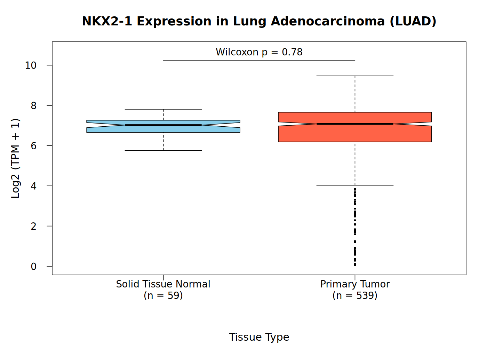

# Project 4: TCGA RNA-seq Data Analysis (NKX2-1 in Lung Adenocarcinoma)

This project compares the expression of the **NKX2-1** gene between **Primary Tumor** and **Solid Tissue Normal** samples in TCGA Lung Adenocarcinoma (LUAD) and shows the result as a boxplot.

## Output



- **X-axis:** tissue type (Solid Tissue Normal, Primary Tumor)
- **Y-axis:** Log2 (TPM + 1)
- Sample sizes are shown in the group labels, and the Wilcoxon p-value is shown on the plot.

## Files

| File | Description |
|------|-------------|
| `NKX2-1_LUAD_boxplot4.R` | R script that reads the data, runs the test and draws the plot |
| `NKX2-1_boxplot.png` | Final boxplot produced by the script |
| `README.md` | This file |

## Data

The input data come from the course figshare link: https://figshare.com/s/fd7276e3583b457bd61d

1. `gdc_sample_sheet.tsv`: sample sheet with the tissue type of each biopsy
2. `gdc_manifest.txt`: manifest file (not used by the script)
3. `tcga_data.tar.gz`: gene expression data (STAR gene counts files)

Unzip the expression data first:

```bash
tar -zxvf tcga_data.tar.gz
```

This creates the `tcga_data/` folder. The data files are not included in this repository because of their size.

## Requirements

- R (tested with `Rscript` on WSL/Ubuntu)
- No extra packages are needed. The script uses only base R and the built-in `parallel` package.

## How to run

Put `gdc_sample_sheet.tsv` and the `tcga_data/` folder in the same directory as the script, then run:

```bash
Rscript NKX2-1_LUAD_boxplot4.R
```

The script prints the sample counts and the p-value, and saves `NKX2-1_boxplot.png` in the same folder. Close any image viewer showing an old copy of the plot first, otherwise the file cannot be overwritten (the script then saves under a time-stamped name instead).

## Method

1. Read `gdc_sample_sheet.tsv` and keep only **Primary Tumor** and **Solid Tissue Normal** samples. All other sample types are ignored.
2. For each sample, open its expression file at `tcga_data/<File ID>/<File Name>`, find the **NKX2-1** row and take the 7th column, `tpm_unstranded`. Files are read in parallel on Linux/WSL to save time.
3. Transform the values as **log2(TPM + 1)**.
4. Check that the example normal sample `e6e83fd4-2f80-44e1-8dce-588a37308dbb` gives the TPM value **53.1718** stated in the assignment. The script stops with an error if it does not.
5. Compare the two groups with a **Wilcoxon rank-sum test** (unpaired, does not assume a normal distribution).
6. Draw a notched boxplot with outliers, the sample sizes and the p-value.

## Results

| Group | Samples (n) |
|-------|-------------|
| Solid Tissue Normal | 59 |
| Primary Tumor | 539 |

- **Wilcoxon p-value = 0.78**
- The median log2(TPM + 1) is similar in both groups, at about 7.
- Primary Tumor samples show a much wider spread, including some samples with very low NKX2-1 expression.

**Conclusion:** in this dataset, NKX2-1 expression does not differ significantly between Primary Tumor and Solid Tissue Normal samples (p = 0.78), so it does not separate tumor from normal tissue on its own by this analysis.

## Notes

- The p-value and plot come directly from the data provided. The sanity check in step 4 confirms that the TPM extraction matches the assignment's example value.
- A boxplot notch that looks narrow or pinched in the middle is normal; it shows the confidence interval around the median.
